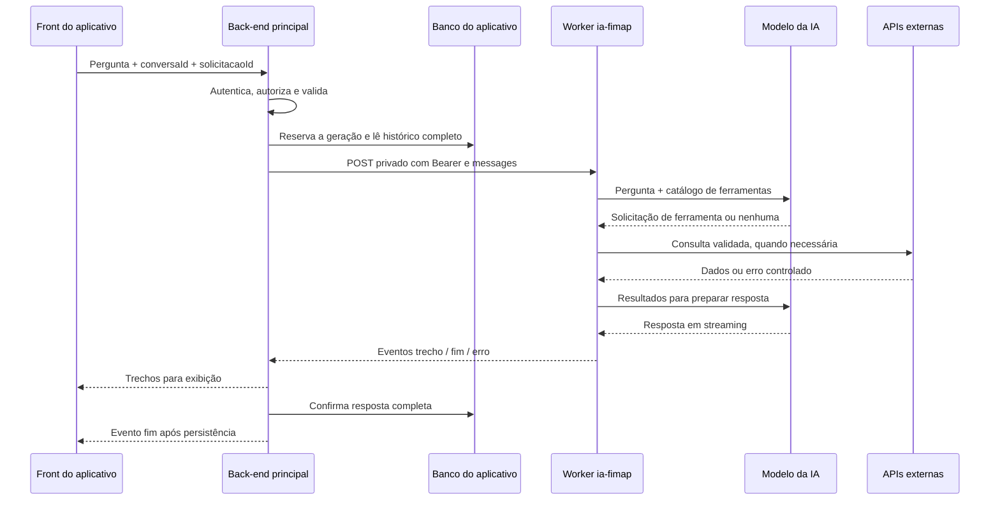

# Guia 1 — Integração do front, back-end e chat da IA

Este documento explica o funcionamento atual e o trabalho necessário no aplicativo principal. As recomendações automáticas citadas aqui são uma proposta futura; não existe um segundo guia neste repositório.

**Referência do código: 12/11/2026.** Os exemplos não dependem de Express, Nest, Django ou outro framework específico. Os caminhos `/api/...` são uma proposta para o seu back-end; não existem neste repositório. O Worker e as rotas `/v1/ia/chat` e `/v1/ia/chat-publico` já existem.

Nenhuma integração garante ausência total de falhas. A implementação deve detectar falhas, preservar o estado correto e permitir recuperação sem misturar usuários, duplicar mensagens ou salvar respostas incompletas como concluídas.

## 1. O que está pronto e o que falta

| Componente | Situação |
| --- | --- |
| Interface demonstrativa em `public/` | Pronta; chama o chat público diretamente |
| `POST /v1/ia/chat-publico` | Pronto; sem autenticação de usuário e sem histórico persistente |
| `POST /v1/ia/chat` | Pronto; exige o secret `CHAT_API_TOKEN` |
| Streaming de resposta da IA | Pronto; protocolo FIMAP com `trecho`, `fim` e `erro` |
| Ferramentas financeiras, Tavily e Geoapify | Implementadas; dependem de credenciais, disponibilidade e plano |
| Adaptador para servidor Node | Disponível em `src/services/publicChatService.js` |
| Login, sessão, autorização e banco do aplicativo | Responsabilidade do seu back-end; não implementados aqui |
| Rotas do aplicativo, histórico e idempotência | Precisam ser implementados no back-end |
| Controle do Worker por usuário autenticado | Precisa ser implementado; hoje os limites são por IP |
| Recebimento estruturado de dados financeiros | Não implementado; o contrato atual utiliza apenas `messages` |
| Recomendações automáticas em JSON | Não implementadas; dependem de projeto futuro |

Na última verificação da publicação, a rota privada retornou `503` porque `CHAT_API_TOKEN` não estava configurado. Isso é um registro da verificação, não uma consulta permanente ao ambiente. Confirme novamente ao integrar.

## 2. Quem faz cada parte



- **Front:** mostra a conversa, envia a pergunta e permite cancelar. Não escolhe qual usuário é dono dos dados e não recebe secrets do Worker.
- **Back-end:** valida login, propriedade da conversa, limites, histórico, persistência e cancelamento. Decide quais dados autorizados podem sair do aplicativo.
- **Worker:** aplica suas próprias validações, coordena ferramentas e fala com o modelo. O token compartilhado identifica o servidor chamador, não autentica individualmente o usuário final.
- **Modelo:** escolhe ferramentas disponíveis e redige a resposta. Não acessa o banco do aplicativo diretamente.
- **Providers:** fazem requisições às APIs usando credenciais do servidor. Cálculos locais não precisam de API.

## 3. Rotas e credenciais que existem hoje

### 3.1 Worker publicado

Base: `https://ia-fimap.fimap-agency.workers.dev`.

| Rota | Autenticação | Uso |
| --- | --- | --- |
| `GET /health` | Sem Bearer | Estado do serviço e formato da configuração da IA |
| `POST /v1/ia/chat` | `Authorization: Bearer CHAT_API_TOKEN` | Integração recomendada entre servidores |
| `POST /v1/ia/chat-publico` | Sem Bearer | Demonstração pública, sem contexto privado injetado pelo back-end |
| `POST /chat` | Mesmo Bearer privado | Compatibilidade legada; SSE do provedor, diferente do protocolo recomendado |

`/health` não faz inferência: não comprova cota disponível, validade do token do modelo nem acesso às APIs. Valide esses itens com chamadas controladas de integração.

Use a rota privada para o aplicativo autenticado. O front principal deve chamar o seu back-end. A página demonstrativa atual não passa automaticamente a usar o back-end depois que um token é criado: sua chamada em `public/assets/chat.js` precisa ser adaptada se essa página for incorporada ao aplicativo principal.

### 3.2 Onde configurar cada segredo

| Configuração | Onde fica | Significado |
| --- | --- | --- |
| `CHAT_API_TOKEN` | Secret do Worker | Autoriza o back-end a chamar o chat privado |
| `CLOUDFLARE_CHAT_TOKEN` | Secrets do back-end | Mesmo valor de `CHAT_API_TOKEN` |
| `CLOUDFLARE_WORKER_URL` | Configuração do back-end | URL completa da rota privada |
| `AI_PROVIDER_ACCOUNT_ID` e `AI_PROVIDER_API_TOKEN` | Secrets do Worker | Conta usada para inferência do modelo |
| `BRAPI_TOKEN`, `HG_BRASIL_API_KEY`, `TAVILY_API_KEY`, `GEOAPIFY_API_KEY` | Secrets do Worker | Credenciais das consultas externas |
| Sessão/JWT do usuário e credenciais Open Finance | Back-end principal | Login e acesso autorizado aos dados do usuário |

Não reutilize a credencial da Cloudflare como token entre back-end e Worker. Não coloque nenhum desses valores em variáveis públicas do front, Git, mensagens, query strings de links públicos ou logs.

### 3.3 Preparação, na ordem

1. Gere um token aleatório forte em um gerenciador de segredos. Por exemplo, use 32 bytes aleatórios criptográficos. Guarde o valor sem publicá-lo em terminais compartilhados.
2. No diretório deste repositório, execute:

   ```sh
   npx wrangler secret put CHAT_API_TOKEN --config wrangler.jsonc
   ```

   Cole somente o token quando solicitado. No Dashboard, use tipo **Secret**, não Texto.
3. Configure no ambiente do seu back-end:

   ```dotenv
   CLOUDFLARE_WORKER_URL=https://ia-fimap.fimap-agency.workers.dev/v1/ia/chat
   CLOUDFLARE_CHAT_TOKEN=VALOR_DO_MESMO_TOKEN_COMPARTILHADO
   ```

   O marcador acima deve ser substituído apenas no ambiente privado. Não versionar um arquivo preenchido.
4. Reinicie/republique o back-end para carregar a configuração. O `.env` do back-end não configura o Worker; são dois ambientes separados.
5. Verifique `/health` e faça um teste da rota privada sem token, com token errado e com token correto.
6. Só libere o front autenticado após os testes de histórico, streaming, isolamento e limites descritos ao final.

Para desenvolvimento local do Worker, copie `.dev.vars.example` para `.dev.vars` e preencha apenas a cópia. Não use credenciais de produção em testes automatizados.

## 4. Contrato atual do Worker

### 4.1 Pedido

```http
POST /v1/ia/chat
Authorization: Bearer TOKEN_DO_SERVIDOR
Content-Type: application/json
```

```json
{
  "messages": [
    { "role": "user", "content": "Recebo R$ 5000 e gasto R$ 3200 por mês." },
    { "role": "assistant", "content": "A diferença informada é R$ 1800 por mês." },
    { "role": "user", "content": "Como posso organizar essa sobra?" }
  ]
}
```

Regras atuais, verificadas em `src/index.ts`:

- De 1 a 12 mensagens; a última deve ser `user`.
- Nas rotas `/v1/ia/...`, os papéis aceitos são `user` e `assistant`. O Worker adiciona o prompt; não envie `system`.
- Cada `user` tem até 2000 caracteres; cada `assistant` no contexto tem até 16000.
- O back-end deve enviar até cinco pares anteriores completos e a pergunta atual: normalmente até 11 mensagens.
- O código verifica `Content-Length` acima de 262144 e também limita o comprimento do texto lido. O limite do texto é medido em caracteres JavaScript; não é um limitador incremental de bytes. Não confunda isso com autorização para enviar extratos grandes.
- Propriedade da conversa, ordem dos pares, deduplicação e reconstrução confiável do histórico são responsabilidade do back-end.
- `usuarioId`, `contextoFinanceiro` e outros campos extras não têm integração implementada. O código atual lê `messages`; acrescentar campos no JSON não ativa essas funcionalidades.

Não aceite do front um histórico arbitrário como se tivesse sido produzido pelo servidor. Receba a pergunta atual e carregue no banco o histórico pertencente ao usuário autenticado.

### 4.2 Exemplo mínimo de chamada no servidor

Exemplo Node.js 22; demonstra o pedido, não substitui controller, autenticação e persistência:

```js
const response = await fetch(process.env.CLOUDFLARE_WORKER_URL, {
  method: 'POST',
  headers: {
    'Content-Type': 'application/json',
    Authorization: `Bearer ${process.env.CLOUDFLARE_CHAT_TOKEN}`,
  },
  body: JSON.stringify({ messages }),
  signal: AbortSignal.any([
    abortController.signal,
    AbortSignal.timeout(180000),
  ]),
});

if (!response.ok) {
  const retryAfter = response.headers.get('Retry-After');
  const failure = await response.json().catch(() => null);
  // Converter para o erro do aplicativo; não começar um stream de sucesso.
  throw Object.assign(new Error('Não foi possível iniciar a resposta.'), {
    status: response.status,
    retryAfter,
    codigo: failure?.codigo,
  });
}

if (!response.headers.get('Content-Type')?.includes('text/event-stream')) {
  await response.body?.cancel();
  throw new Error('Formato de resposta inesperado.');
}
```

`messages` e `abortController` precisam ser construídos pelo controller. Um controller deve cancelar esse sinal quando a resposta ao navegador for encerrada prematuramente; verifique os eventos corretos do seu framework. Não trate o simples fim da leitura do corpo POST como cancelamento da resposta de streaming.

### 4.3 Resposta em streaming

Antes do início do stream, falhas HTTP retornam JSON. Depois que o stream começa, o status pode continuar `200` mesmo havendo erro em um evento.

```text
data: {"tipo":"trecho","conteudo":"Vamos organizar "}

data: {"tipo":"trecho","conteudo":"sua reserva."}

data: {"tipo":"fim"}

```

Falha durante a geração:

```text
data: {"tipo":"erro","mensagem":"A conexão com a IA foi interrompida."}

```

Regras para o parser:

1. Use `TextDecoder` com leitura incremental; uma letra UTF-8 pode chegar dividida entre pacotes.
2. Acumule conteúdo até a linha vazia que separa eventos. Um pacote de rede não corresponde a um evento.
3. Considere separadores LF e CRLF; preserve o restante do buffer para a próxima leitura.
4. Some apenas eventos `trecho` à resposta visível. `erro` é falha; `fim` confirma a conclusão do modelo.
5. EOF sem `fim`, JSON inválido ou resposta sem texto são falha/incompletude, mesmo com HTTP 200.
6. No back-end, só envie o `fim` definitivo ao front depois de confirmar a gravação no banco. Se a gravação falhar, não confirme sucesso ao usuário.

O adaptador [publicChatService.js](../src/services/publicChatService.js) já envia Bearer, trata divisão de eventos, cancelamento e resposta incompleta. Ele depende de [chatProtocol.js](../src/services/chatProtocol.js); leve ambos ao back-end preservando o import, ou adapte os caminhos.

A função é `gerarResposta(messages, onChunk, signal)`. O callback atual `onChunk` é chamado de forma síncrona e não é aguardado. Para um proxy de produção com cliente lento, implemente escrita com backpressure no controller/parser; não presuma que um callback `async` será aguardado. Não grave no banco a cada token. Limite o acúmulo de saída e cancele clientes que excedam o orçamento definido.

## 5. Contrato proposto entre front e seu back-end

**As rotas desta seção precisam ser criadas no aplicativo principal.** Use os nomes como referência e adapte sem alterar o contrato privado do Worker.

| Método e rota proposta | Comportamento |
| --- | --- |
| `POST /api/ia/conversas` | Cria conversa para o usuário da sessão |
| `GET /api/ia/conversas/:id/mensagens` | Lê somente mensagens da conversa autorizada |
| `POST /api/ia/conversas/:id/mensagens` | Recebe pergunta, reserva geração e devolve SSE |
| `GET /api/ia/solicitacoes/:id` | Recupera estado da geração após desconexão |
| `POST /api/ia/solicitacoes/:id/cancelar` | Solicita cancelamento da geração do próprio usuário |

Corpo proposto do envio ao back-end:

```json
{
  "solicitacaoId": "b1e35ba1-88e7-4dc3-8a03-010000000001",
  "versaoConversa": 3,
  "mensagem": "Como posso reduzir meus gastos recorrentes?"
}
```

- `solicitacaoId`: UUID criado uma vez para essa ação do usuário. Reenvios da mesma ação usam o mesmo ID; uma nova pergunta usa outro ID.
- `versaoConversa`: permite detectar que duas abas tentaram avançar a mesma conversa simultaneamente. Divergência deve retornar `409` e solicitar atualização do histórico.
- Não receba `usuarioId` como autoridade. Derive usuário/tenant da sessão validada e confira a propriedade do `:id` em toda operação.
- Se houver autenticação por cookie, aplicar a proteção CSRF usada pelo aplicativo. Se front e back estiverem em domínios diferentes, configurar CORS e cookies somente para as origens necessárias.
- O front usa `fetch` com POST e lê `response.body`. `EventSource` nativo usa GET e não corresponde diretamente ao envio acima.

Estados do front: `pronto`, `enviando`, `respondendo`, `concluido`, `cancelado`, `erro`. Desabilite envio duplicado enquanto uma geração está ativa na conversa. “Nova conversa” deve cancelar a anterior ou desacoplar explicitamente a visualização, sem associar trechos antigos à conversa nova.

## 6. Persistência, concorrência e reenvio sem duplicação

Estrutura mínima a criar no banco do back-end:

| Entidade | Campos essenciais |
| --- | --- |
| Conversa | `id`, `usuarioId`, `tenantId` se aplicável, `versao`, datas |
| Mensagem | `id`, `conversaId`, `papel`, `conteudo`, `estado`, ordem, datas |
| Geração | `solicitacaoId`, `usuarioId`, `conversaId`, hash do pedido, estado, tentativa, lease/expiração, motivo do erro |

Estados sugeridos da geração: `recebida → gerando → concluida`; saídas alternativas `falhou` e `cancelada`. Uma geração abandonada por queda do processo precisa ser recuperada por expiração de lease, não ficar eternamente em `gerando`.

Sequência do controller:

1. Autenticar, validar o corpo e autorizar a conversa.
2. Em transação, verificar `solicitacaoId` e hash, conferir a versão da conversa e reservar uma única geração ativa.
3. Salvar a pergunta e a mensagem de resposta em estado pendente. Definir restrição única por usuário e solicitação; usar lock/compare-and-swap no banco, não um `Map` em memória do servidor.
4. Repetição de ID com outro conteúdo/conversa: `409`. Mesmo ID concluído: devolver/reconstituir a resposta salva. Mesmo ID ainda em execução: informar que já está em andamento, sem iniciar outra inferência.
5. Reconstruir até cinco pares anteriores concluídos. Perguntas de tentativas falhas e respostas parciais não entram como pares completos no próximo contexto.
6. Chamar o Worker privado e encaminhar os trechos com backpressure.
7. Ao receber `fim`, gravar resposta completa e marcar geração concluída em uma transação. Depois confirmar o `fim` ao front.
8. Em cancelamento, timeout ou falha, marcar o estado correspondente. Se guardar texto parcial para recuperação visual, identificá-lo explicitamente como incompleto e excluí-lo do contexto automático.
9. Se o banco confirmou conclusão, mas o front perdeu o último evento, o front consulta o estado pela mesma solicitação. Não gera outra resposta automaticamente.

A idempotência descrita é do seu back-end. O Worker atual não recebe uma chave de idempotência nem armazena resultados duráveis. Um timeout entre back-end e Worker não prova que não houve consumo do modelo. Antes de repetir, reconcilie o estado da geração e limite tentativas; não prometa consumo exatamente uma vez.

## 7. Limites que precisam de atenção antes de vários usuários

### 7.1 Limites atuais do Worker

| Recurso | Comportamento atual |
| --- | --- |
| Intervalo entre perguntas | 5 segundos por IP, em memória da instância |
| Rate limiter Cloudflare | 12 pedidos por 60 segundos, chaveada por IP |
| Ferramentas por pergunta | Até 4 pedidos novos, em até 3 rodadas |
| HTTP financeiro | Padrão de 8 tentativas HTTP por pergunta; teto configurável de 12 |
| Concorrência HTTP financeira | Padrão de 4 por ambiente/instância |
| Orçamento diário HTTP financeiro | Padrão de 100 por ambiente/instância; não é um contador global durável |
| Repetição HTTP financeira | Uma repetição por padrão, conforme erro e espera permitida |
| Pesquisa Tavily | Uma busca por pergunta por padrão; teto configurável de 3 |
| Espera de planejamento | Padrão de 15 segundos por rodada |
| Espera HTTP financeira | Padrão de 6 segundos por tentativa |
| Espera REST por chamada ao modelo | Até 120 segundos |
| Adaptador Node | Até 180 segundos para a operação |

Esses prazos são aplicados em camadas; não se deve somá-los como se fossem garantia de duração da pergunta. Cancelamento e prazo global precisam interromper etapas restantes.

### 7.2 Ajuste obrigatório para o aplicativo

Com back-end intermediário, usuários podem chegar ao Worker pelo mesmo IP de saída e compartilhar os limites. O Worker não recebe automaticamente o IP real do navegador, e não deve confiar em um cabeçalho arbitrário enviado pelo front para contornar limites.

Antes do lançamento com vários usuários:

1. Aplicar no back-end limites por usuário/tenant e no máximo uma geração ativa por conversa.
2. Alterar o Worker para aceitar uma referência opaca de usuário enviada apenas pelo servidor autenticado, depois de validar Bearer. Se usar um cabeçalho como `X-Fimap-User-Ref`, ele é uma **extensão proposta**, ainda não implementada.
3. Definir chaves separadas para chat e recomendações. A referência enviada pelo back-end é contexto de controle, não substitui a autorização dos dados no próprio back-end.
4. Manter limites de segurança globais e por serviço. Usar armazenamento/coordenador apropriado para orçamento global; contadores em memória não garantem teto entre instâncias.
5. Impedir que novos campos privados sejam aceitos na rota pública. O contexto financeiro do usuário nunca deve depender de um ID informado livremente nessa rota.

## 8. Tratamento de erros e recuperação

| Sinal | Tratamento no back-end/front |
| --- | --- |
| `400` | Corrigir mensagens/campos; não repetir sem alteração |
| `401` do Worker | Conferir token compartilhado; não pedir login bancário nem repetir em loop |
| `403` do Worker | Conferir origem enviada e configuração; não encaminhar `Origin` do navegador ao Worker sem necessidade |
| `404` / `405` | Conferir URL e método |
| `413` | Reduzir contexto; não truncar números ou JSON financeiro de forma cega |
| `429` com `AI_QUOTA` | Suspender novas gerações e respeitar `Retry-After`; informar indisponibilidade temporária |
| Outros `429` | Respeitar `Retry-After`; limitar reenvios e manter a pergunta recuperável |
| `503` sem token/configuração | Corrigir configuração; `/health` não comprova que o token do chat existe |
| `502`, timeout ou conexão perdida | Conferir estado persistido; repetir somente se necessário, com orçamento e tentativa identificada |
| HTTP 200 com evento `erro` | Marcar falha; não salvar como resposta concluída |
| EOF sem `fim` | Marcar resposta incompleta; oferecer recuperação/reenvio controlado |
| Banco indisponível após a geração | Não confirmar `fim` ao front; registrar reconciliação durável quando possível |
| API externa indisponível | A IA deve informar a limitação e não inventar dados; o chat pode concluir com resposta explicativa |

Nas falhas de consulta de ferramentas, o erro pode chegar à IA como dado e ela produzir uma resposta válida explicando a indisponibilidade. Isso difere de uma geração do modelo interrompida: não classifique toda menção a erro no texto como falha de transporte.

Não faça retry automático depois de já mostrar parte de uma resposta, anexando a nova geração à anterior. Uma nova tentativa deve ter estado visual próprio e ligação explícita à solicitação original.

## 9. Streaming, proxy e logs

- Encaminhar `Content-Type: text/event-stream; charset=utf-8` e `Cache-Control: no-cache, no-transform`.
- Desabilitar buffering/compressão que acumule a resposta no proxy do back-end. Testar no domínio real, não apenas em localhost.
- O prazo de proxy/load balancer deve permitir o tempo definido para a geração. Se usar comentários SSE como heartbeat, eles não são tokens do modelo nem indicam conclusão; essa emissão no back-end precisa ser implementada.
- Propagar cancelamento e encerrar leitores de rede em `finally`.
- Renderizar Markdown com sanitização; conteúdo da IA e de páginas externas não é HTML confiável.
- Registrar IDs de correlação, estados, tempos, código de falha e contagens. Não registrar Bearer, secrets, extrato integral ou prompt financeiro em logs operacionais.
- O logger financeiro registra nomes conhecidos das ferramentas, sucesso/código de erro e contagens de requisições/cache/falhas; não oferece rastreabilidade completa de negócio nem histórico persistente.

## 10. Roteiro de implementação e testes de aceite

Executar nesta ordem:

1. Preparar secrets e chamada privada em ambiente de testes.
2. Criar tabelas/constraints, autenticação e autorização de conversas.
3. Criar controller de envio com reserva idempotente e histórico do servidor.
4. Implementar parser/proxy SSE, cancelamento, backpressure e persistência antes do `fim`.
5. Adaptar o front do aplicativo, incluindo recuperação por `solicitacaoId`.
6. Implementar controle de usuários/concorrência no Worker antes do uso compartilhado em escala.
7. Testar a rede completa e publicar gradualmente. Manter o chat público de demonstração separado dos dados do aplicativo.

Casos que devem passar antes de liberar:

- [ ] Sem token e com token errado, a rota privada não gera resposta.
- [ ] Com token correto, uma pergunta simples termina com `fim` e fica salva uma vez.
- [ ] Usuário A não lê, envia, cancela ou recupera conversa/solicitação do usuário B.
- [ ] Duas abas enviando a mesma solicitação não geram duas respostas.
- [ ] Duas abas com versões diferentes recebem conflito e não embaralham o histórico.
- [ ] Acentos e eventos divididos em múltiplos pacotes permanecem corretos.
- [ ] Falha do modelo antes/depois do primeiro trecho não vira sucesso falso.
- [ ] Desconexão antes de `fim`, cliente lento e cancelamento liberam os recursos.
- [ ] Falha de banco depois do `fim` do Worker não confirma conclusão ao front.
- [ ] Perda da conexão após commit permite recuperar resposta sem nova inferência.
- [ ] Limites afetam o usuário correto; várias contas não são bloqueadas apenas por compartilhar o IP do back-end.
- [ ] Token, histórico de outro usuário e dados bancários não aparecem no navegador/logs indevidamente.
- [ ] Pesquisa ou API indisponível produz limitação explícita, sem cotação inventada.

Para os testes existentes deste repositório: `npm test`, `npm run typecheck` e `npm run build`. Perguntas reais consomem a cota do modelo. Os testes existentes não substituem os testes do seu back-end, banco, fila ou proxy.

Na implantação, publicar primeiro extensões compatíveis do Worker, depois o back-end e por último o front. Em rollback, desativar novas solicitações e preservar gerações/histórico; não apagar estados pendentes para esconder falhas. Rotação de token deve ser coordenada entre os dois servidores, pois o contrato atual aceita um único `CHAT_API_TOKEN` por vez.

## 11. Onde alterar o código

| Arquivo/local | Trabalho |
| --- | --- |
| `src/index.ts` | Recepção privada, validações e limites do Worker; novas extensões precisam preservar o contrato do chat |
| `src/services/aiProvider.js` | Comunicação com modelo; não é lugar para login, banco ou regras de propriedade do usuário |
| `src/services/financial/financialChatOrchestrator.js` | Escolha e execução coordenada das ferramentas |
| `src/services/financial/financialToolRegistry.js` | Ferramentas disponíveis e validação dos argumentos |
| `src/services/publicChatService.js` + `chatProtocol.js` | Adaptador de servidor e parser de eventos |
| Seu back-end | Controller, sessão, banco, autorização, idempotência, proxy e reconciliação |
| Seu front | Envio ao back-end, renderização, estados e recuperação |

Para explicar no chat uma recomendação já salva, o back-end primeiro autoriza o cartão e carrega seu conteúdo. O contrato de contexto estruturado deve ser desenvolvido em versão própria; não acrescente `contextoFinanceiro` ao corpo atual supondo que será lido. Texto resumido inserido em `messages` continua sujeito aos limites atuais e não equivale a um contrato financeiro validado.

## Referências

- [Secrets na Cloudflare](https://developers.cloudflare.com/workers/configuration/secrets/): configuração privada das credenciais.
- [Streams nos Workers](https://developers.cloudflare.com/workers/runtime-apis/streams/): implementação de fluxos de resposta.
- [Auditoria de 13/11/2026](audit-2026-11-13.md): histórico, causas verificadas e prevenção.
